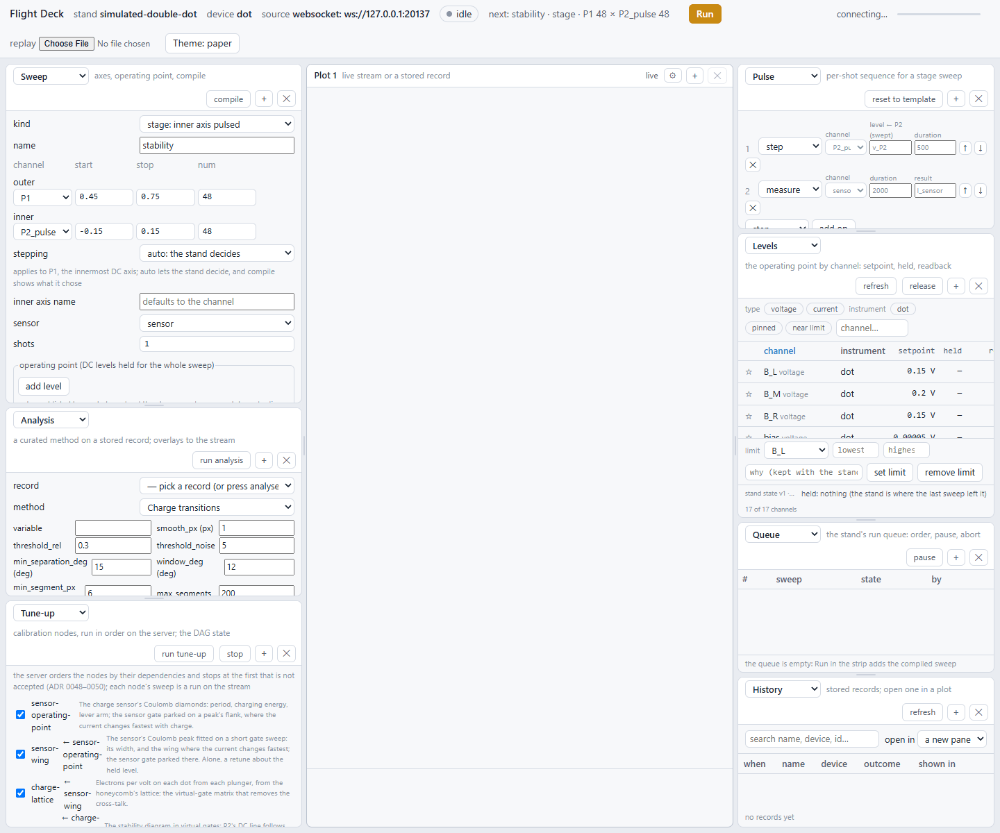
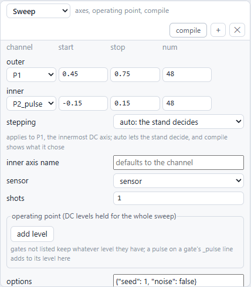
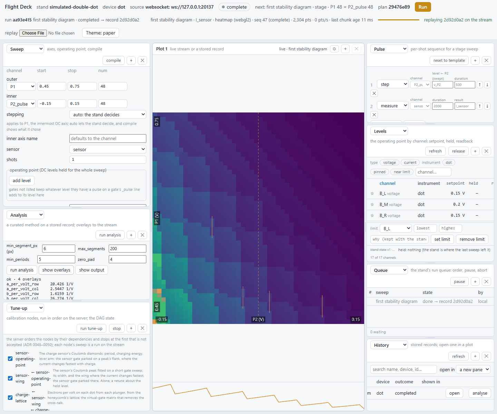
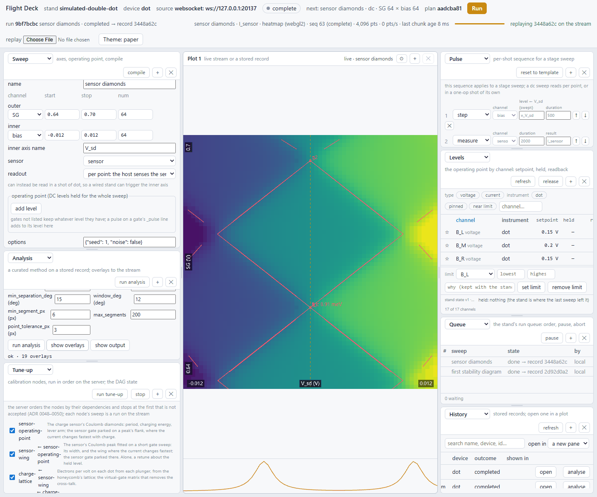
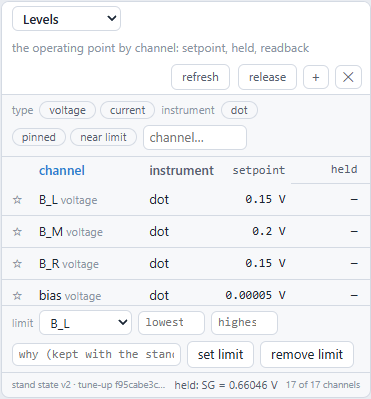
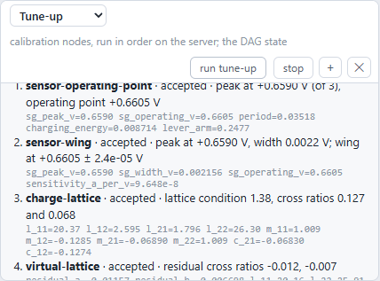
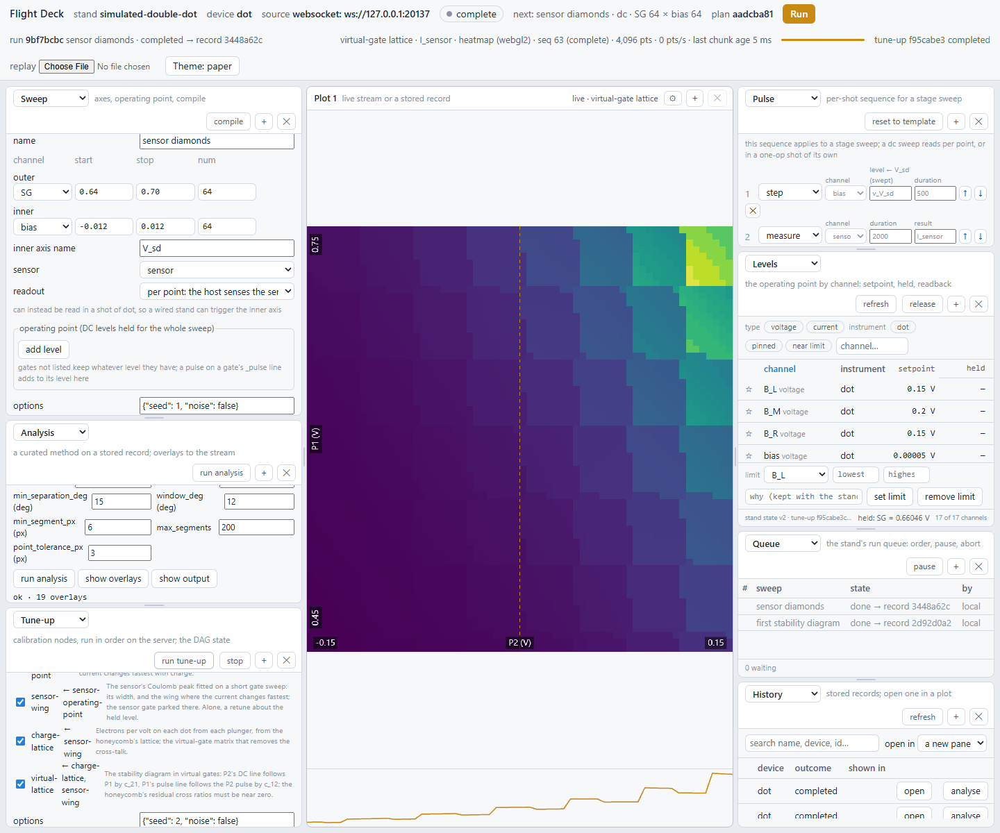

# Run the simulated stand and drive it from Flight Deck

This guide starts qdt's simulated stand on your own computer and walks through controlling it from Flight
Deck, qdt's browser front end. By the end you will have:
- measured a stability diagram and found its charge transitions;
- measured the charge sensor's Coulomb diamonds;
- moved the operating point, and opened and closed the middle barrier to merge and separate the dots;
- run the four-node tune-up.

Nothing here needs an instrument. The stand runs the same server, the same run queue and the same
registry as the bench, so what you learn here carries over to a real stand.

## What the simulated stand is

The stand is one simulated instrument wired to a simulated device. The device comes from
[Phantom](https://github.com/CowboyQuantum/phantom), a separate simulator of gate-defined quantum dots that
qdt pins at version `v0.4.0` (ADR 0087, ADR 0088, ADR 0090, ADR 0091). It is a silicon–germanium double
dot with a charge sensor that is a quantum dot of its own:

- **Twelve gates.** The plungers `P1` and `P2` set each dot's energy. The barriers `B_L`, `B_M` and `B_R`
  separate the dots from each other and from the leads, and they set how fast electrons tunnel through.
  They also move and reshape the dots, and the middle barrier `B_M` sets how strongly the two dots are
  coupled to each other.
  The reservoir gates `R_L` and `R_R` fill the leads. The sensor gate `SG` tunes the charge sensor's dot.
  The sensor barriers `SB_L` and `SB_R` sit on either side of it and set how fast electrons tunnel into
  and out of the sensor. The sensor bath gates `SR_L` and `SR_R` fill the leads the sensor draws its
  current from. Every gate starts at the device's programmed point (0.6 V on `P1` and `P2`, 0.4 V on
  `SB_L`, 0.3 V on `SB_R`), except `SG`, which starts at about 0.651 V, where the sensor reads.
- **Two pulse lines,** `P1_pulse` and `P2_pulse`. A pulse adds to its gate's direct-current (DC) level,
  as a bias tee does.
- **The sensor's source–drain bias,** `bias`, which starts at 50 µV, with its own pulse line `bias_pulse`.
- **The sensor,** whose current (in amperes) is what every measurement reads.
- **A simulated oscilloscope,** `scope` on channel `scope1`, for time-resolved captures.

The device is physical rather than a toy. About 20 electrons sit on each dot at the programmed point, and
each dot gains one electron for every 40 to 50 mV on its plunger. The sensor's peaks are about 35 mV apart
on `SG`. Each peak is a few millivolts wide, because electrons tunnel through the sensor barriers fast
enough to broaden it, and it turns on steeply as `SG` rises. One electron on a dot moves the sensor by more
than a peak's width. So the stand starts `SG` on the low side of a peak, about 10 mV below its steepest
point, where the plungers' own pull on the sensor and each electron's kick keep it on one slope. The
readout noise is realistic too: it falls as the square root of the integration time, so a 2 µs reading is
mostly noise and a 1 ms reading is clean. Two devices are committed: `two-dot-sige-a`, the default, and
`two-dot-sige-b`, a second disorder draw of the same design.

The coupling between the two dots follows every gate, and the plungers raise it almost as strongly as
`B_M` does. So in a stability diagram 0.15 V either side of where the stand starts, the lower left shows
two separate dots, and the upper right, about 40 % of the window, shows one merged dot: there the two dots
have joined into a single larger dot. Opening `B_M` grows the merged part and closing it shrinks it
(section 4).

## Before you start

You need:
- [uv](https://docs.astral.sh/uv/), which installs the right Python and every package;
- [Node.js](https://nodejs.org/) 20 or newer, which comes with `corepack`, to build Flight Deck;
- a clone of this repository, with network access to GitHub the first time, because `uv` fetches
  Phantom from its repository.

Install everything from the repository's root:

```bash
uv sync --all-packages --all-extras
```

## Start the stand

### The quick way: one command

```bash
uv run python scripts/demo_control_path.py
```

This builds Flight Deck the first time (it needs `corepack`), starts the stand server against the
simulated device, serves Flight Deck from the same server and opens your browser at
<http://127.0.0.1:8700/>. It prints a short walkthrough of this guide. Stop it with Ctrl+C.

Useful options:
- `--root <folder>` keeps the records in another registry, for example a throwaway folder. The default
  is `~/.qdt/registry`.
- `--rebuild` rebuilds Flight Deck after you change its code.
- `--no-browser` does not open a browser.

### The development way: two terminals

Use this when you are changing Flight Deck, because Vite reloads the page on every save.

```bash
# terminal 1, at the repository's root: the stand server
uv run python -m qdt_server

# terminal 2: Flight Deck (run pnpm from apps/flightdeck so corepack uses the pinned version)
cd apps/flightdeck
corepack pnpm install
corepack pnpm dev
```

Open the address Vite prints, normally <http://localhost:5173/>. Flight Deck finds the server by itself:
- its application programming interface (API) at `http://127.0.0.1:8700`;
- its data stream at `ws://127.0.0.1:8765`.

If you moved either one, add `?api=…` or `?ws=…` to Flight Deck's address.

Either way, the server's interactive API documentation is at <http://127.0.0.1:8700/docs>.

## The workspace



- **The top strip** names the stand (`simulated-double-dot`) and the device (`dot`), shows the stream's
  state and the next run, and holds the one **Run** button.
- **The left column** holds **Sweep** (what to measure), **Analysis** (a method on a stored record) and
  **Tune-up** (the calibration nodes).
- **The centre** holds the plots. Each plot follows the live stream or is pinned to one record. Its ⚙
  menu chooses the variable, a transform such as the derivative, and a line cut.
- **The right column** holds:
  - **Pulse**, the sequence each shot plays;
  - **Levels**, every channel's setpoint, held level and readback;
  - **Queue**, the stand's run queue;
  - **History**, the stored records.

Each pane's title is a menu, so any pane can show any widget. The `+` button adds a pane below and `✕`
closes it. The layout is remembered in your browser.

> **The Sweep form opens about where the stand sits.** Each stepped axis opens 0.3 V wide, centred on the
> level its channel is held at, or on the instrument's setpoint when nothing is held. A pulse line opens
> about 0, because a pulse adds to its gate's DC level. Choosing another channel, or changing a level in
> **Levels**, centres the window again. Once you type an axis's start or stop, the form leaves that axis
> alone.

## 1. Measure a stability diagram

A stability diagram steps `P1` on its DC line and pulses `P2` inside each shot. The sensor's current
changes in a step each time a dot gains an electron, which draws the honeycomb of charge transitions.

In **Sweep**:
1. Leave **kind** at `stage: inner axis pulsed`, and name the sweep.
2. Check that the **outer** axis is `P1` from `0.45` to `0.75` with `48` points. The form opened it
   0.15 V either side of `P1`'s 0.6 V.
3. Check that the **inner** axis is `P2_pulse` from `-0.15` to `0.15` with `48` points. These are
   offsets, because the pulse adds to `P2`'s 0.6 V DC level.
4. Set **options** to `{"seed": 1, "noise": false}`. With noise off, the template's 2 µs reading is
   enough. To measure with noise on, change the `measure` row's **duration** in **Pulse** to `1000000`
   (1 ms) or more.
5. Press **compile**. The plan box shows what the server will do. On this stand the device triggers the
   `P1` axis itself, so no marker line is needed.



Press **Run** in the top strip. The sweep joins the stand's queue, runs, and draws live in the plot. When
the strip says `completed → record …`, the record is in the registry.


The steps sit on top of a strong slope, because the plungers also move the sensor. Choose the derivative
in the plot's ⚙ menu to make the transitions stand out. The honeycomb of charge transitions fills the
lower left. Towards the upper right the steps turn into fainter diagonal lines, where the two dots have
merged into one.

## 2. Find the charge transitions

1. In **History**, press **refresh**, then **analyse** on the new record. This selects it in Analysis.
2. In **Analysis**, choose the method **Charge transitions**, set **threshold_rel** to `0.1`, and press
   **run analysis**. The default of 0.3 keeps only edges near a third of the strongest gradient, and on
   this sensor the steepest corner of the slope sets that, so the steps elsewhere fall under it. The
   estimates come out the same either way.
3. Press **show overlays** to replay the record with the detected segments drawn on it. Press **show
   output** to see the map the method detected on.



The estimates are electrons per volt on each dot from each plunger. On the default device they come out
near 20.4 and 26.3 on the diagonal, which is the device's own lattice within half a percent. The two
cross terms come out only within about 6 %, because the merged corner makes the honeycomb uneven and the
method assumes it repeats evenly. The result is stored with the record, and the method's name, version and every
parameter are kept with it.

## 3. Measure the sensor's Coulomb diamonds

The diamonds give the sensor's charging energy, peak spacing and lever arm. This is a DC sweep: both axes
are stepped from the host, and the sensor is read at every point.

In **Sweep**:
1. Set **kind** to `DC: both axes stepped, sensed`, and name the sweep.
2. Set the **outer** axis to `SG` from `0.64` to `0.70` with `64` points. That is two sensor peaks just
   above where `SG` starts.
3. Set the **inner** axis to `bias` from `-0.012` to `0.012` with `64` points, and set **inner axis
   name** to `V_sd`. The diamonds' tips sit near ±9 mV, the sensor's charging energy over the electron
   charge.
4. Keep **sensor** at `sensor`, and set **options** to `{"seed": 1, "noise": false}`.

Press **Run**. Then analyse the record with **Coulomb diamonds** and **show overlays**.



The default device gives a charging energy of about 8.8 meV and a peak spacing of about 35 mV on `SG`.

## 4. Move the operating point

The stand holds an operating point: a level for each channel that every later sweep inherits unless the
sweep moves that channel itself.

- **In Levels**, type a value in a channel's box and press **set**. The value is applied and held.
  **release** forgets the held point and leaves the stand where it is.
- **On a map**, click a point, and Levels offers the clicked coordinates as levels to set. This is right
  for `P1` on its DC line. On a pulsed axis it currently sets the gate's DC level to the pulse offset, not
  to the voltage you clicked; issue #150 tracks it. Set `P2` in Levels instead.
- **In a sweep**, **add level** holds a channel for that sweep alone.



A limit on a channel (set in Levels, with a reason) makes the server refuse every level and every sweep
that would cross it, rather than clamp it. Each change is a new, versioned stand state.

### See the gates on a drawing of the device

The **Device** widget draws the device's twelve gates as seen from above, to scale, from the layout in
Phantom's device file. Each gate is filled with a colour for the level it sits at: the held level if
there is one, otherwise the instrument's setpoint. To open it, choose **Device** in the menu at the top of
any side pane.

- **The colour bar** under the drawing runs from the lowest gate level to the highest. The menu in the
  pane's head switches the colormap between viridis, magma and grey.
- **The scale bar** next to it shows the length of 100 nm at the drawing's current size.
- **The legend** lists every gate with its level. A gate's label inside the drawing appears only when the
  pane is large enough to fit it, so enlarge the pane to see the levels on the gates themselves. Hovering
  over a gate shows its role, its channel and its level.
- **The dashed outlines** are the conducting channel under the gates and the sensor's island.

The drawing follows the stand: a level set in Levels, by a click on a map, or by a finished run appears
within two seconds. It shows DC levels only, so a pulse line's offset is not drawn. A real stand has no
layout yet, and the widget says so.

### Merge and separate the dots with the middle barrier

`B_M` sets how strongly the two dots are coupled. Opening it lets an electron pass between the dots more
easily. That widens the short edges where the honeycomb's lines meet, and past a point it joins the two
dots into one, whose transitions are diagonal lines.

1. In **Levels**, set `B_M` to `0.14` and press **set**. It starts at its programmed 0.2 V.
2. Run the stability diagram of step 1 again, with the same windows and `{"seed": 1, "noise": false}`.
   The honeycomb now reaches further up and to the right, and only about a fifth of the window is merged.
3. Set `B_M` to `0.24` and run it again. More than half of the window is now one merged dot.
4. Set `B_M` back to `0.2` when you are done. **release** would leave it where it is.

The sensor keeps reading across this range. `B_L` and `B_R` move and reshape the dots too, so a barrier
gate moves the plunger lines further than its coupling to the dots alone would.

## 5. Run the tune-up

The tune-up runs four calibration nodes in order on the server. Each node's sweep is an ordinary run on
the stream, so you can watch it:
- **sensor-operating-point** finds the sensor's peaks from its diamonds;
- **sensor-wing** fits one peak and parks `SG` on its steepest flank;
- **charge-lattice** measures the stability diagram with `SG` 10 mV below that flank, on the peak's tail,
  and decides the virtual-gate matrix;
- **virtual-lattice** measures again in virtual gates, with `SG` in the same place, and checks that the
  transitions come out straight.

In **Tune-up**, leave the four nodes ticked, set **options** to `{"seed": 2, "noise": false}` and press **run
tune-up**. The sensor nodes need noise off, because their peak fit does not survive the device's noise.
The node windows come from the server and already suit the device. The whole tune-up takes under a
minute. Part of the lattice nodes' window is the merged corner, so the lattice comes out within about
1 % on the diagonal and about 6 % on the cross terms.



When it completes, every node is accepted. The server holds `SG` at the wing it found, and the last plot
is the stability diagram in virtual gates. For a stability diagram of your own after the tune-up, set `SG`
10 mV below the held wing in **Levels** first, where the lattice nodes read it.



## Run options

**options** in Sweep and Tune-up is a small JSON (JavaScript Object Notation) object. On the simulated
stand it takes:

| Option | What it does |
|---|---|
| `seed` | The noise seed: the same seed gives the same noise, another seed a new realisation. The device's own disorder is fixed by its file. |
| `noise` | `true` or `false`: whether the device's noise is on. |
| `dynamics` | `true` or `false` (the default): whether Phantom's charge dynamics are on. Off, each reading's charge is an independent draw from the thermal distribution at that point. On, the dots' charge and the sensor's own charge evolve in time with tunnel rates that follow the gates. Closing a barrier such as `B_L`, or a sensor barrier such as `SB_L`, then slows tunnelling until a sweep lags behind the gates, a parked reading switches between two charge states, and the sensor reads in single-electron bursts. With `B_M` open, dot 1 also fills through dot 2, so closing `B_L` alone does not isolate it: close `B_L` and `B_M` together. On Phantom 0.4.0, as on 0.3.0, a dot that must lose two or more electrons at once keeps one too many (Phantom issue #64). A stability diagram, whose rows start low, is then wrong over much of the map, so try dynamics on short windows and parked readings for now. A sweep takes about ten times longer with dynamics on: a 48 × 48 stability diagram takes about 3 s without and 26 s with. |
| `device` | Which committed device to load: `two-dot-sige-a` (the default) or `two-dot-sige-b`. Any other name fails the run. |
| `campaign` | A label kept on the record, to find it later. |
| `tau_s`, `droop_v`, `scope_noise_v` | The simulated scope's recorded droop: its time constant in seconds, its step in volts and its noise in volts. |

## The queue, the records and starting again

- **Run** adds the sweep to the stand's queue. In **Queue** you can move or remove a waiting entry, abort
  the running one, or pause the queue. An aborted run keeps what it streamed, recorded as aborted.
- Every completed run is a record in the registry: by default `~/.qdt/registry`, or the folder `--root`
  names. **History** lists the records, and **open** shows one in a new plot.
- Restarting the server keeps every record. It offers the held operating point again in Levels, and
  nothing is re-applied until you press **re-apply**.
- To start from nothing, stop the server and start it with a new, empty folder as `--root`.

## When something looks wrong

| What you see | Why, and what to do |
|---|---|
| The map is speckled noise. | The reading is too short for the noise. Set `"noise": false`, or raise the `measure` duration in Pulse to 1 ms or more. |
| The map is a smooth slope with no steps. | The window is away from the electrons. Type a window about the channel's level in **Levels**, such as 0.45 to 0.75 V for `P1` as in step 1. |
| The upper right of a stability diagram has faint diagonal lines instead of a honeycomb. | There the two dots have merged into one, because the plungers raise the coupling between them. Close `B_M` a little in **Levels**, for example to 0.14 V, or move the window lower. |
| Flight Deck shows no stand, or every command fails. | The server is not running, or it is on another port. Start `python -m qdt_server`, or pass `?api=` and `?ws=` in Flight Deck's address. |
| `address already in use` when starting. | Another server is running. Stop it, or start this one with `--port` and `--stream-port`. |
| A command from another computer is refused. | Commands from another computer need a token. Run `uv run python -m qdt_server --add-token "<desk>"`, start the server with `--host 0.0.0.0`, and open Flight Deck there with `?token=<token>` once. |
| A sweep is refused with "would reach". | A limit on that channel forbids it. Change the sweep, or remove the limit in Levels. |

## Going further

- [Tutorials](../tutorials/README.md) do the same things from Python scripts, and CI runs them.
- [The Phantom cutover](../steps/06d-phantom-cutover.md), ADR 0087 and ADR 0088 explain how the simulator
  is built and pinned. ADR 0090 and ADR 0091 explain what each Phantom release changed for the stand.
- On the bench, the same server runs real instruments: `python -m qdt_server --stand stand.json
  --device-id <id>` (see [BENCH.md](../BENCH.md)). Flight Deck does not change.

## Regenerating these screenshots

The pictures in this guide come from a script that walks the steps above. After a change to Flight
Deck, retake them from `apps/flightdeck`:

```bash
corepack pnpm screenshots
```

It builds Flight Deck and starts its own stand server with an empty registry on free ports. Then it drives
a headless Chrome through steps 1 to 5 and writes the eight files in `docs/guides/img/`, reduced to 256
colours. It prints the estimates it saw, so you can check the numbers this guide quotes. A step that
does not complete stops it with an error, and no picture is changed. It takes about a minute.
